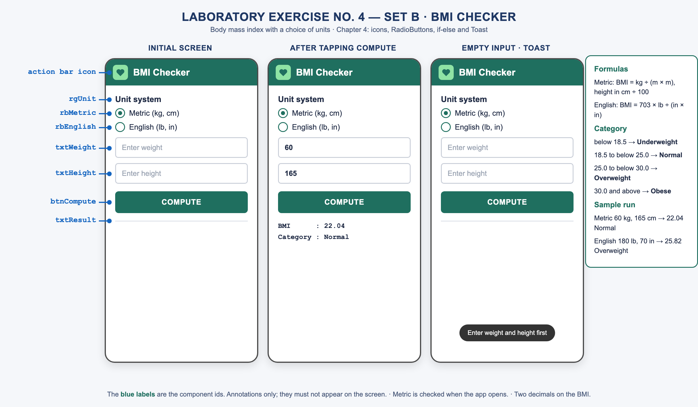

# Laboratory Exercise 4 — Set B: BMI Checker

**MD 101 – Mobile Application Development 1 · Chapter 4: Icons and Decision-Making Components**
Pangasinan State University, Lingayen Campus · Instructor: Jayson E. Tamayo

A body mass index checker. The nurse chooses the unit system, enters the weight and the height, and the app shows the BMI and its category.



## Formulas

| Units | BMI |
|---|---|
| Metric (kg, cm) | weight ÷ (height ÷ 100)² |
| English (lb, in) | 703 × weight ÷ height² |

## Categories

Test one boundary per branch, lowest range first. A BMI of exactly 25.0 is Overweight.

| BMI | Category |
|---|---|
| below 18.5 | Underweight |
| 18.5 to below 25.0 | Normal |
| 25.0 to below 30.0 | Overweight |
| 30.0 and above | Obese |

## Sample runs

| Units | Weight | Height | BMI | Category |
|---|---|---|---|---|
| Metric | 60 kg | 165 cm | 22.04 | Normal |
| English | 180 lb | 70 in | 25.82 | Overweight |

## Components

The blue labels on the mockup are the ids. They are annotations only and must not appear on the screen.

| Id | Component | Text or hint |
|---|---|---|
| `rgUnit` | RadioGroup | holds the two RadioButtons |
| `rbMetric` | RadioButton | Metric (kg, cm) — checked when the app opens |
| `rbEnglish` | RadioButton | English (lb, in) |
| `txtWeight` | EditText | hint "Enter weight", inputType numberDecimal |
| `txtHeight` | EditText | hint "Enter height", inputType numberDecimal |
| `btnCompute` | Button | Compute |
| `txtResult` | TextView | empty when the app opens |

## What the app must do

1. Read both values with `getText()` and convert them with `Double.parseDouble()`.
2. Use `isChecked()` on the RadioButtons to pick the Metric or the English formula.
3. Use an if-else-if chain with relational operators for the category, as in the table above.
4. Show two lines, as in the mockup: BMI with two decimals, and Category.

```
BMI      : 22.04
Category : Normal
```

## Add-ons

- **Toast.** If either field is empty when Compute is tapped, show the Toast *Enter weight and height first* and do not compute.
- **Launcher icon.** Make a custom icon (a heart, a scale or any health symbol) with Image Asset Studio.
- **Action bar icon.** Show the same icon in the action bar through code.

## Rules

- Work individually. Name the project `LabEx4_Lastname`.
- Read every value from the screen at run time; never hard-code the sample values.
- All screen text goes in `strings.xml`.
- Every component the Java code references needs a descriptive id (`rbMetric`, `txtWeight`), not an Android Studio default (`radioButton2`, `editTextNumber`).
- The app must run on the emulator without closing unexpectedly, including when Compute is tapped with an empty field.
- No AI assistance (AIAS Level 1). You must be able to explain any line of your code during the demonstration.

## Scoring — 50 points

| Item | Full points when | Points |
|---|---|---|
| RadioGroup and RadioButtons | Both options with the mockup's labels, in one RadioGroup, Metric checked at start | 5 |
| Input fields | Two EditTexts with the hints from the mockup and a numeric inputType | 5 |
| Decision | `isChecked()` picks the right formula; the if-else-if chain gives the right category for every range | 10 |
| Computation and output | Correct BMI for both unit systems, two labelled lines, two decimals | 10 |
| Resources, ids and run | Text in `strings.xml`, descriptive ids, no crash | 5 |
| **Base score** | | **35** |
| Add-on: Toast on empty input | Shows the mockup's message, no crash | 5 |
| Add-on: custom launcher icon | Generated with Image Asset Studio, visible on the home screen | 5 |
| Add-on: action bar icon | The same icon shown in the action bar from code | 5 |
| **Total** | | **50** |

An item that is present but wrong earns about half of its points. An app that does not build earns no add-ons. Work that is not your own earns 0.

## Before you submit

Run the app. Try both unit systems and a value in every category. Tap Compute with a field empty. Compare your output with the sample runs, character by character. Then zip the project folder.
